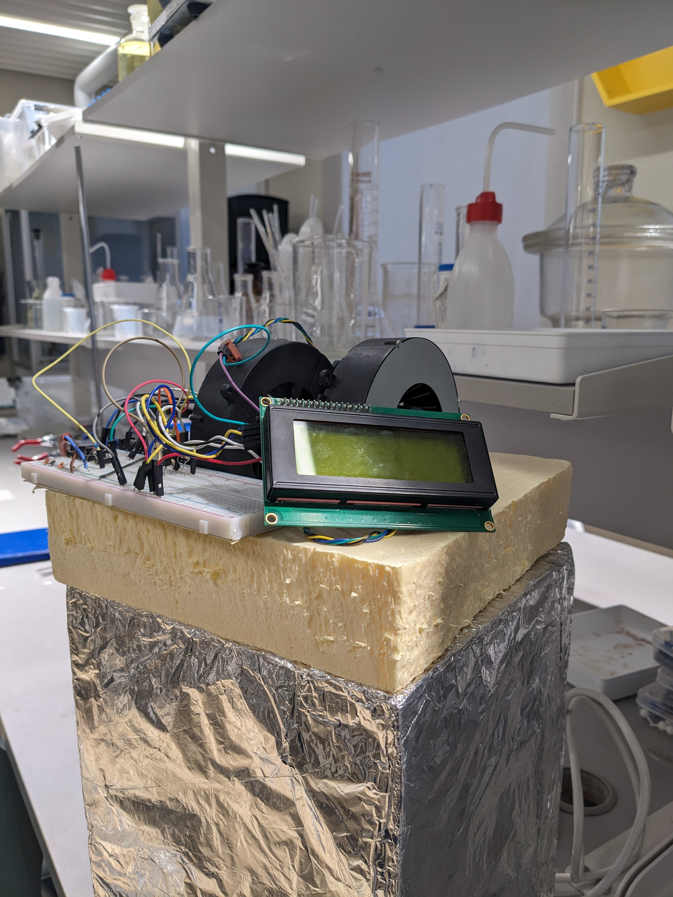

# Аппарат для контроля температуры химического раствора
**АРХИВНЫЙ РЕПОЗИТОРИЙ ПРОЕКТА 2023 ГОДА**

Аппарат нагревает раствор до заданной температуры и плавно снижает температуру до комнатной в течение заданного времени.

В проекте использовались Arduino Nano в качестве отладочной платы и программный ПИД-регулятор для контроля температуры.
